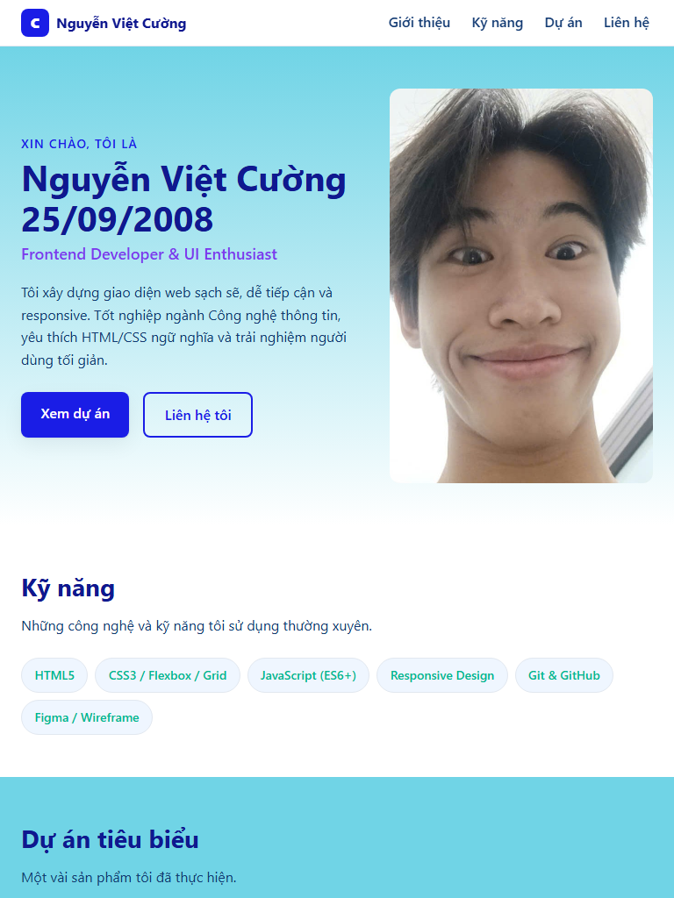
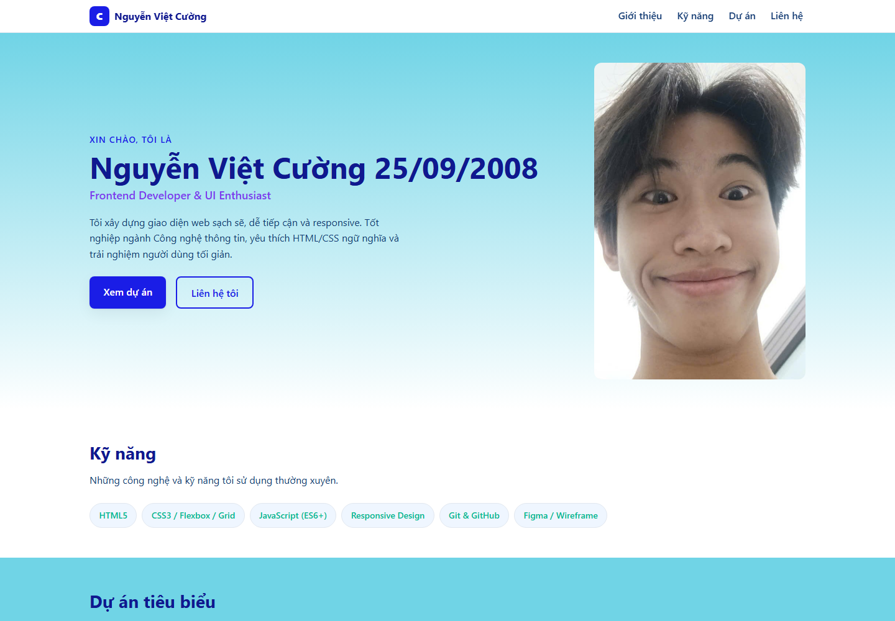

# BÁO CÁO KIỂM THỬ TRƯỚC BÀN GIAO

## 1. Tiêu đề báo cáo & Thông tin chung

| Thông tin | Chi tiết |
|---|---|
| Tên dự án | My-CV — Portfolio Nguyễn Việt Cường |
| Phiên bản | v1.0 |
| Ngày kiểm thử | 05/11/2026 |
| Người thực hiện/đánh giá | QA/QC — đánh giá sơ bộ dựa trên mã nguồn và tài liệu hiện có |
| Phạm vi | Rà soát mã nguồn/tài liệu và kiểm tra hiển thị cục bộ bằng Microsoft Edge tại các viewport mobile, tablet, desktop; chưa kiểm thử trên thiết bị vật lý hoặc trình duyệt khác |
| Tài liệu tham chiếu | [README](../README.md), [Release note](./RELEASENOTE.md), [trang chính](../index.html), [stylesheet](../assets/css/styles.css) |

> **Quy ước trạng thái:** **Đạt** = có thể xác nhận trong phạm vi đã kiểm tra; **Chưa đạt** = phát hiện vấn đề cụ thể; **Cần cải thiện** = chưa có đủ minh chứng hoặc cần kiểm tra/bổ sung trước khi bàn giao. Các kết quả dưới đây không thay thế cho kiểm thử thực tế trên trình duyệt.

## 2. Bảng tổng quan trạng thái

| # | Nhóm tiêu chí | Trạng thái | Tóm tắt |
|---|---|---|---|
| 1 | Tính đúng đắn và mức độ đáp ứng yêu cầu chức năng | Cần cải thiện | Các khu vực nội dung và điều hướng chính hiện diện; liên kết email chưa hoạt động đúng. |
| 2 | Giao diện, trải nghiệm người dùng và khả năng tương thích | Cần cải thiện | Đã chụp tại ba viewport; ảnh mobile cho thấy nội dung bị cắt ngang và alt ảnh đại diện chưa khớp. |
| 3 | Khả năng vận hành, xử lý lỗi và hiệu năng cơ bản | Cần cải thiện | Đã mở trang cục bộ để chụp ảnh; chưa xác nhận lỗi console/tài nguyên hoặc đo hiệu năng. |
| 4 | Bảo mật, quản lý cấu hình và dữ liệu | Cần cải thiện | Không thấy luồng backend hoặc cấu hình bí mật trong phạm vi rà soát; cần kiểm tra khi triển khai và rà soát liên kết ngoài. |
| 5 | Chất lượng mã nguồn, cấu trúc repository và tài liệu bàn giao | Cần cải thiện | Có cấu trúc đơn giản và tài liệu hướng dẫn; còn một số nội dung/đường dẫn cần chỉnh và chưa có kiểm tra tự động. |
| 6 | Khả năng triển khai, kiểm thử và cung cấp minh chứng | Cần cải thiện | Đã có ảnh Responsive tại ba viewport; chưa có biên bản kiểm thử triển khai hoặc xác nhận trên môi trường bàn giao. |

## 3. Nội dung chi tiết từng tiêu chí

### 3.1. Tính đúng đắn và mức độ đáp ứng yêu cầu chức năng

| Hạng mục kiểm tra | Trạng thái | Ghi chú/Minh chứng |
|---|---|---|
| Có các khu vực Giới thiệu, Kỹ năng, Dự án và Liên hệ | Đạt | Các section tương ứng có trong `index.html`; menu điều hướng trỏ tới các ID này. |
| Hiển thị danh sách kỹ năng và dự án | Đạt | Mã nguồn khai báo các kỹ năng và bốn thẻ dự án có tiêu đề, mô tả, ảnh và liên kết. |
| Điều hướng nội bộ đến các khu vực trang | Đạt | Các liên kết menu sử dụng `#about`, `#skills`, `#projects` và `#contact`. Chưa xác nhận bằng thao tác trình duyệt. |
| Liên kết email mở đúng chức năng gửi thư | Chưa đạt | Liên kết email đang dùng `href="#"`; nên đổi thành `mailto:cuongnguyen259208@gmail.com`. |
| Nội dung hồ sơ chính xác và nhất quán | Cần cải thiện | Cần chủ sản phẩm xác nhận thông tin cá nhân, mô tả học vấn và nội dung từng dự án trước khi phát hành. |

### 3.2. Giao diện, trải nghiệm người dùng và khả năng tương thích

| Hạng mục kiểm tra | Trạng thái | Ghi chú/Minh chứng |
|---|---|---|
| Bố cục responsive tại viewport mobile, tablet và desktop | Chưa đạt | Đã chụp tại ba kích thước viewport. Ở mobile (390 × 844), một phần nội dung giới thiệu bị cắt ở mép phải. Xem ảnh minh chứng bên dưới; cần sửa và chụp lại để xác nhận. |
| Ảnh có văn bản thay thế | Cần cải thiện | Các ảnh có thuộc tính `alt`, nhưng alt ảnh đại diện ghi “Nguyễn Văn An” trong khi nội dung hồ sơ là Nguyễn Việt Cường. Cần sửa cho chính xác. |
| Đường dẫn tài nguyên ảnh tương thích nhiều môi trường | Cần cải thiện | Các ảnh dự án đang ghi đường dẫn với dấu `\` trong `src`; nên chuẩn hóa thành `/` và kiểm tra tải ảnh trên máy chủ triển khai. |
| Điều hướng và nội dung dễ sử dụng trên màn hình nhỏ | Cần cải thiện | CSS có quy tắc cho màn hình nhỏ nhưng chưa có kết quả kiểm thử thực tế ở các kích thước viewport phổ biến. |
| Tương thích trình duyệt và hỗ trợ tiếp cận | Cần cải thiện | Chưa kiểm thử trên các trình duyệt/thiết bị; cần kiểm tra tương phản, thứ tự focus bàn phím, nhãn liên kết và trình đọc màn hình. |

#### Minh chứng Responsive

Ảnh được chụp cục bộ bằng Microsoft Edge ở các kích thước viewport nêu dưới đây. Đây là viewport giả lập trên máy tính, không phải ảnh chụp từ thiết bị vật lý. Ảnh mobile cho thấy nội dung giới thiệu bị cắt ngang; kết quả responsive hiện **Chưa đạt**.

| Thiết bị/viewport giả lập | Kích thước | Minh chứng |
|---|---:|---|
| Mobile | 390 × 844 px | [responsive-mobile.png](./screenshots/responsive-mobile.png) |
| Tablet | 768 × 1024 px | [responsive-tablet.png](./screenshots/responsive-tablet.png) |
| Desktop | 1440 × 1000 px | [responsive-desktop.png](./screenshots/responsive-desktop.png) |

### 3.3. Khả năng vận hành, xử lý lỗi và hiệu năng cơ bản

| Hạng mục kiểm tra | Trạng thái | Ghi chú/Minh chứng |
|---|---|---|
| Trang tải theo mô hình tĩnh, không cần bước build | Đạt | README cho biết dự án dùng HTML/CSS tĩnh và có thể mở bằng trình duyệt hoặc phục vụ bằng máy chủ tĩnh. |
| Tải trang và tài nguyên không phát sinh lỗi | Cần cải thiện | Trang đã mở cục bộ để chụp ảnh viewport; chưa kiểm tra lỗi console, lỗi tải tài nguyên hoặc liên kết hỏng. |
| Xử lý khi tài nguyên hoặc liên kết ngoài không khả dụng | Cần cải thiện | Chưa có minh chứng kiểm tra tình huống ngoại tuyến hoặc khi trang dự án bên ngoài không truy cập được. |
| Hiệu năng tải trang cơ bản | Cần cải thiện | Chưa đo thời gian tải, dung lượng ảnh hoặc chỉ số hiệu năng bằng công cụ trình duyệt. |

### 3.4. Bảo mật, quản lý cấu hình và dữ liệu

| Hạng mục kiểm tra | Trạng thái | Ghi chú/Minh chứng |
|---|---|---|
| Không phụ thuộc backend hoặc cơ sở dữ liệu để hiển thị trang | Đạt | Phạm vi hiện tại là portfolio tĩnh theo README và mã nguồn được rà soát. |
| Quản lý cấu hình và thông tin bí mật | Cần cải thiện | README ghi dự án không dùng biến môi trường hay cấu hình bí mật; cần xác nhận lại trên toàn bộ mã nguồn trước khi phát hành. |
| Liên kết tới dịch vụ bên ngoài | Cần cải thiện | Trang có liên kết tới các dự án GitHub Pages và GitHub cá nhân; cần xác nhận đích đến, nội dung và quyền truy cập trước khi bàn giao. |
| Dữ liệu cá nhân được công bố có chủ đích | Cần cải thiện | Trang hiển thị email và thông tin cá nhân; chủ sản phẩm cần xác nhận việc công khai các dữ liệu này. |

### 3.5. Chất lượng mã nguồn, cấu trúc repository và tài liệu bàn giao

| Hạng mục kiểm tra | Trạng thái | Ghi chú/Minh chứng |
|---|---|---|
| Tách nội dung HTML, kiểu dáng CSS và tài nguyên ảnh | Đạt | Có `index.html`, `assets/css/styles.css` và thư mục `assets/img/`. |
| Có hướng dẫn cài đặt/chạy dự án | Đạt | README mô tả mở trực tiếp, chạy máy chủ Python và tùy chọn chạy bằng Docker. |
| Tài liệu phát hành có thông tin phiên bản | Đạt | [RELEASENOTE.md](./RELEASENOTE.md) ghi phiên bản v1.0, ngày phát hành, chức năng và hạn chế. |
| Nội dung mã nguồn nhất quán, dễ bảo trì | Cần cải thiện | Cần sửa alt ảnh đại diện, chuẩn hóa đường dẫn ảnh và rà soát nội dung hiển thị để thống nhất với hồ sơ thực tế. |
| Có quy tắc kiểm tra chất lượng tự động | Cần cải thiện | Trong phạm vi repository được rà soát chưa thấy cấu hình hoặc báo cáo kiểm thử tự động; cần bổ sung nếu yêu cầu bàn giao có quy định này. |

### 3.6. Khả năng triển khai, kiểm thử và cung cấp minh chứng

| Hạng mục kiểm tra | Trạng thái | Ghi chú/Minh chứng |
|---|---|---|
| Có hướng dẫn phục vụ trang cục bộ | Đạt | README có lệnh Python HTTP server và địa chỉ truy cập localhost. |
| Có phương án triển khai bằng Docker | Đạt | README hướng dẫn chạy Nginx bằng Docker với thư mục dự án được mount; chưa xác nhận lệnh chạy thành công. |
| Triển khai lên môi trường mục tiêu và kiểm tra sau triển khai | Cần cải thiện | Chưa có thông tin môi trường bàn giao hoặc biên bản xác nhận URL triển khai hoạt động. |
| Có kết quả kiểm thử lặp lại được | Cần cải thiện | Báo cáo này là rà soát tĩnh; chưa có test case đã chạy, kết quả pass/fail hoặc log kiểm thử trình duyệt. |
| Có minh chứng trực quan và thông tin phiên bản bàn giao | Cần cải thiện | Chưa đính kèm ảnh chụp các viewport, danh sách trình duyệt/thiết bị hoặc thông tin build/deploy. |

## 4. Đánh giá tổng kết & Đề xuất

### Nhận định chung

My-CV có cấu trúc portfolio tĩnh rõ ràng, các khu vực chính và hướng dẫn chạy cơ bản đã được chuẩn bị. Tuy nhiên, báo cáo hiện dựa trên rà soát mã nguồn/tài liệu, không phải một đợt kiểm thử thực thi đầy đủ. Chưa đủ minh chứng để xác nhận khả năng tương thích, vận hành và triển khai trên môi trường bàn giao.

**Đề xuất trạng thái bàn giao: Chưa sẵn sàng xác nhận bàn giao cuối cùng.** Có thể chuyển sang vòng xác nhận sau khi xử lý các mục chưa đạt và hoàn thành kiểm thử thực tế.

### Vấn đề cần xử lý trước khi bàn giao

1. Sửa liên kết email từ `href="#"` sang `mailto:cuongnguyen259208@gmail.com`.
2. Sửa văn bản alt ảnh đại diện cho đúng chủ thể.
3. Chuẩn hóa đường dẫn ảnh dự án sang dấu `/` và xác nhận ảnh tải thành công trên máy chủ mục tiêu.
4. Xác nhận nội dung hồ sơ, mô tả dự án, email và các liên kết ngoài với chủ sản phẩm.
5. Kiểm thử điều hướng, ảnh, liên kết và bố cục trên ít nhất một trình duyệt desktop và một thiết bị/màn hình di động; lưu lại kết quả và ảnh minh chứng.
6. Chạy thử quy trình triển khai dự kiến (máy chủ tĩnh hoặc Docker) và ghi nhận URL, thời điểm, môi trường cùng kết quả.

### Điều kiện đề nghị đóng kiểm thử

- Các lỗi nêu trên đã được xử lý hoặc có chấp thuận ngoại lệ từ chủ sản phẩm.
- Các kiểm tra thực tế được chạy lại và không còn lỗi nghiêm trọng ảnh hưởng chức năng chính.
- Bằng chứng kiểm thử và thông tin triển khai được bổ sung vào hồ sơ bàn giao.